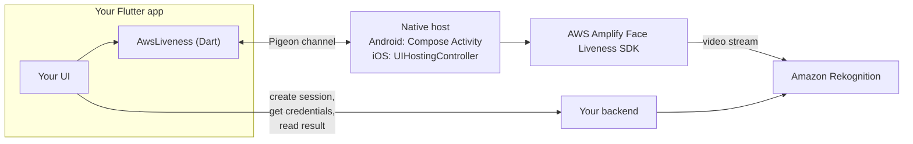

Production-ready Flutter integration for
Amazon Rekognition Face Liveness.

Built on the official AWS Amplify
Face Liveness SDKs for iOS and Android.

> **Unofficial.** Not affiliated with, endorsed or sponsored by Amazon Web Services.
>
> Amazon Web Services, AWS, Amazon Rekognition and AWS Amplify are trademarks of
> Amazon.com, Inc. or its affiliates. They are used here only to describe compatibility.
> See [NOTICE](NOTICE).

# aws_liveness_for_flutter

Native [Amazon Rekognition Face Liveness](https://docs.aws.amazon.com/rekognition/latest/dg/face-liveness.html)
for Flutter. The plugin shows the official AWS Amplify liveness screen (Jetpack Compose on
Android, SwiftUI on iOS) and returns a typed result. No WebView, no Cognito, no Amplify
configuration file, and no changes to your `MainActivity` or `AppDelegate`.

## Status

Version 0.1.0 has not been published yet. What has and has not been verified:

| Area | State |
|---|---|
| Dart API | Implemented; unit tests with over 99% line coverage of `lib/src` |
| Android host | Implemented; JVM unit tests, debug and R8 release builds pass |
| iOS host | Implemented; **not yet built in Xcode**. Swift sources are syntax-checked and the platform-free core is unit-tested on Linux. Xcode build, XCTest and the CocoaPods fallback are pending macOS CI |
| Real devices | **Pending** on both platforms: no liveness check has been run on a phone yet |
| Real AWS end to end | **Pending**: needs a device and an AWS account |

The [manual test checklist](doc/manual-test-checklist.md) tracks the device checks. Treat the
package as a preview until those are done.

## Features

- One call, `AwsLiveness.start`, that returns `LivenessCompleted`, `LivenessCancelled` or
  `LivenessFailed`; runtime failures are values, never exceptions.
- 26 stable error codes with a category, `isRetryable`, a recovery suggestion and the raw
  native details.
- Bring your own credentials: a Dart callback returns short-lived AWS credentials from your
  backend. No Cognito identity pool needed.
- Both challenges: FaceMovement (front or back camera) and FaceMovementAndLight; your
  backend chooses per session.
- Camera permission handled for you, plus helpers and `openAppSettings()`.
- `cancel()`, a timeout, backgrounding and engine detach all end an attempt exactly once.
- Light, dark or system theme with nine colour overrides shared by both SDKs.
- Localizable: SDK strings and the plugin's own strings can be overridden by the app.

## How it fits together



Your backend creates the session, vends credentials that can only stream a liveness check,
and reads the verdict. The app never decides whether a user is live. More in
[doc/architecture.md](doc/architecture.md).

## Requirements

| | Minimum |
|---|---|
| Flutter / Dart | 3.38 / 3.10 |
| Android | `minSdk 24`, `compileSdk 36`, Android Gradle Plugin 8.6, Kotlin 2.1 |
| iOS | 15.0, Swift Package Manager enabled |
| AWS | A [region with Face Liveness](doc/troubleshooting.md#regions), a backend you run |

Details and what is tested: [doc/compatibility.md](doc/compatibility.md).

## Install

```sh
flutter pub add aws_liveness_for_flutter
```

### Android

The Amplify SDK needs core library desugaring in your **app** module
(`android/app/build.gradle.kts`). `MainActivity` stays unchanged.

```kotlin
android {
    compileOptions { isCoreLibraryDesugaringEnabled = true }
}
dependencies {
    coreLibraryDesugaring("com.android.tools:desugar_jdk_libs:2.1.5")
}
```

The plugin declares the `CAMERA` permission and marks every camera feature as optional, so
Google Play does not filter devices without one.

### iOS

Add a camera usage description to `ios/Runner/Info.plist`:

```xml
<key>NSCameraUsageDescription</key>
<string>We use the camera to check that you are a real person.</string>
```

The Amplify liveness SDK ships only through **Swift Package Manager**. Enable it once:

```sh
flutter config --enable-swift-package-manager
```

Flutter 3.44 and later enable it by default. If your app still builds with **CocoaPods**, the
plugin compiles without the SDK: `checkAvailability()` reports `sdkUnavailable` and `start`
fails with `sdkUnavailable`. A CocoaPods build also needs this line in `ios/Podfile`:

```ruby
platform :ios, '15.0'
```

## Quick start

```dart
import 'package:aws_liveness_for_flutter/aws_liveness_for_flutter.dart';

Future<void> runLivenessCheck(MyBackend backend) async {
  // 1. Your backend calls CreateFaceLivenessSession. Use a new session per attempt.
  final session = await backend.createSession();

  // 2. Run the check. The plugin asks for the camera permission if needed.
  final result = await AwsLiveness.start(
    LivenessRequest(
      sessionId: session.id,
      region: session.region, // for example 'eu-west-1'
      credentialsProvider: () async {
        // Short-lived credentials allowed only rekognition:StartFaceLivenessSession.
        final c = await backend.fetchLivenessCredentials(session.id);
        return LivenessCredentials(
          accessKeyId: c.accessKeyId,
          secretAccessKey: c.secretAccessKey,
          sessionToken: c.sessionToken,
          expiration: c.expiration,
        );
      },
      timeout: const Duration(minutes: 3),
    ),
  );

  // 3. Only your backend decides the outcome.
  switch (result) {
    case LivenessCompleted():
      final isLive = await backend.isLive(session.id); // GetFaceLivenessSessionResults
      print('Backend decision: $isLive');
    case LivenessCancelled(:final reason):
      print('Cancelled by ${reason.name}');
    case LivenessFailed(:final error):
      print('${error.code.name} (${error.category.name}), '
          'retryable: ${error.isRetryable}: ${error.recoverySuggestion}');
  }
}
```

`start` throws only for programming errors, synchronously: `ArgumentError` for a blank
session id, a malformed region or a non-positive timeout, and `StateError` if an earlier
`start` has not completed. Call `AwsLiveness.cancel()` to end the active attempt; the pending
`start` completes with `LivenessCancelled(reason: LivenessCancelReason.app)`.

A complete example lives in [`example/`](example). Three backend examples show the
server side; all of them keep the decision on the server and give the app credentials
that can only stream a check:

| Example | What it shows |
|---|---|
| [`examples/backend-express`](examples/backend-express) | Node.js + Express; the quickest way to try the example app locally |
| [`examples/backend-lambda`](examples/backend-lambda) | AWS CDK: HTTP API, Lambda authorizer, three Lambdas, DynamoDB session binding, per-function least-privilege roles |
| [`examples/cognito`](examples/cognito) | AWS CDK: Cognito user and identity pools, plus a Flutter snippet mapping `Amplify.Auth.fetchAuthSession()` to `credentialsProvider` |

## Results and errors

`LivenessCompleted` means the video reached Rekognition. It does **not** mean the user is
live: ask your backend, which calls `GetFaceLivenessSessionResults` and compares the
confidence with its own threshold.

`LivenessFailed.error` is a `LivenessError`:

| Field | Meaning |
|---|---|
| `code` | A stable `LivenessErrorCode`, for example `sessionNotFound` or `cameraPermissionPermanentlyDenied` |
| `category` | `permission`, `credentials`, `configuration`, `service`, `interrupted`, `device`, `timeout` or `unknown` |
| `isRetryable` | Whether a new attempt with a new session may succeed without code changes |
| `message`, `recoverySuggestion` | English, for developers and logs; map `code` to your own user-facing text |
| `nativeDetails` | Native error name and message, for bug reports |
| `cause` | The exception your `credentialsProvider` threw, if any (never sent to native code) |

The full code table and the native mapping are in [doc/design.md §4](doc/design.md).

## Permissions

`start` checks and requests the camera permission itself. For your own rationale screen:

```dart
final status = await AwsLiveness.getCameraPermissionStatus();
if (status == CameraPermissionStatus.permanentlyDenied) {
  await AwsLiveness.openAppSettings();
}
```

`checkAvailability()` tells you, without prompting, whether the SDK is linked, a camera
exists and, on iOS, `NSCameraUsageDescription` is set. Platform differences are listed in
[doc/platform-parity.md](doc/platform-parity.md).

## Theming

```dart
LivenessRequest(
  // ...
  theme: const LivenessTheme(
    mode: LivenessThemeMode.dark,
    dark: LivenessColors(primary: Color(0xFF00897B)),
  ),
);
```

See [doc/theming.md](doc/theming.md) for the nine tokens and how each SDK applies them.

## Localization

The liveness screen follows the device language. Override the SDKs' strings and the
plugin's two Android strings from your app; key lists and paths are in
[doc/localization.md](doc/localization.md). The plugin ships its own strings in English and
Turkish.

## Photosensitivity

The FaceMovementAndLight challenge flashes a sequence of colours on screen. Some people may
experience epileptic seizures when exposed to coloured lights. For audiences that may
include photosensitive people, have your backend create sessions with the
**FaceMovement** challenge (`ChallengePreferences` in `CreateFaceLivenessSession`).

## Security essentials

- Decide liveness only on your backend. The plugin never returns a score or an `isLive`
  flag.
- Create a new session for every attempt, including retries. Sessions are single use and
  expire about three minutes after creation.
- Give the app temporary credentials that allow only `rekognition:StartFaceLivenessSession`,
  for the shortest time possible. Never ship long-lived AWS keys.
- Call your backend over HTTPS and authenticate your users there.

More in [doc/security.md](doc/security.md) and [SECURITY.md](SECURITY.md).

## Documentation

- [Architecture](doc/architecture.md)
- [Security](doc/security.md)
- [Compatibility](doc/compatibility.md)
- [Platform parity](doc/platform-parity.md)
- [Theming](doc/theming.md) and [localization](doc/localization.md)
- [Troubleshooting](doc/troubleshooting.md)
- [Manual test checklist](doc/manual-test-checklist.md)
- [Releasing](doc/releasing.md) and [contributing](CONTRIBUTING.md)
- [Design](doc/design.md)

## License

Apache-2.0. See [LICENSE](LICENSE) and [NOTICE](NOTICE).
