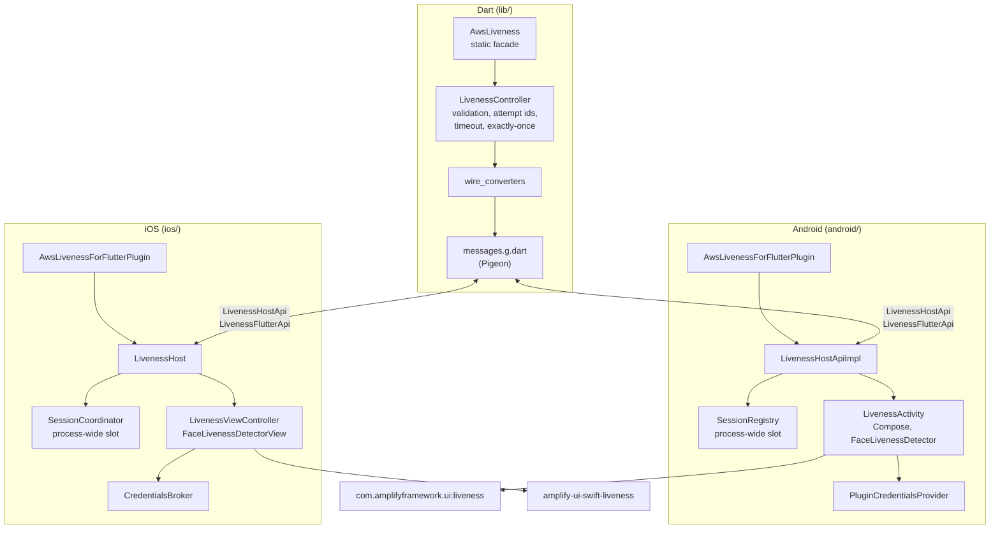
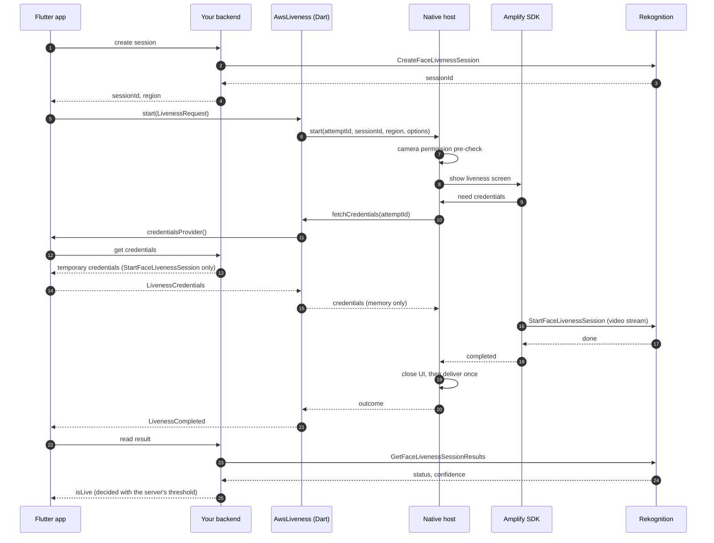
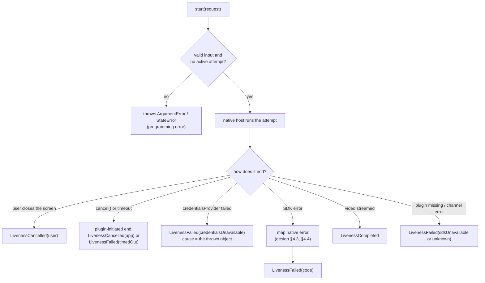

# Architecture

How `aws_liveness_for_flutter` is put together. The decisions behind it are in
[design.md](design.md).

## Components

- **Dart.** `AwsLiveness` is the only public entry point. `LivenessController` validates the
  request, gives every attempt an increasing `attemptId`, completes each attempt exactly
  once, runs the timeout and answers native credential requests.
- **Channel.** [Pigeon](https://pub.dev/packages/pigeon) generates typed Dart, Kotlin and
  Swift code from `pigeons/messages.dart`. `LivenessHostApi` goes from Dart to native;
  `LivenessFlutterApi.fetchCredentials` goes from native to Dart.
- **Native hosts.** Each shows the SDK screen full screen without touching the app's own
  Activity or view controllers: a plugin-owned `ComponentActivity` on Android and a
  `UIHostingController` on iOS. A process-wide single slot makes sure only one attempt runs
  at a time, even with several Flutter engines.
- **SDKs.** The official Amplify UI liveness components do the camera work, the challenge
  and the streaming to Rekognition.

## One liveness check

Notes:

- The provider may run more than once on Android (after a reconnect). On iOS it runs once
  per attempt.
- The result is delivered after the native screen has closed (at most 3 seconds later), so
  the next `start` finds the app in the foreground.
- The app never sees a confidence score from the plugin; only the backend reads it.

## Errors and ending an attempt

The order of precedence when several things happen at once (design §4.2):

1. A user cancel reported by the SDK.
2. A plugin-initiated end (app cancel, timeout, backgrounding, presenter loss, engine detach).
   A real completion that raced the cancel is kept.
3. A failure of your `credentialsProvider`, whatever the SDK reports afterwards.
4. The mapped SDK error.
5. `unknown`, with the native details.

Every attempt produces exactly one result. Three guards make sure of that: the native slot,
the Dart completer and the `attemptId` that native code echoes back. When a Flutter engine
detaches, its attempt is dropped and no result is sent.
