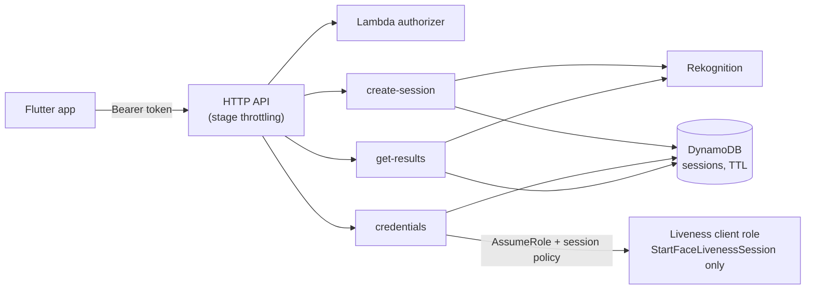

# backend-lambda

Serverless example backend for [`aws_liveness_for_flutter`](../../README.md), deployed
with AWS CDK (TypeScript). It has the same API and security rules as
[`backend-express`](../backend-express), so the [example app](../../example) works with
either.

Why CDK rather than SAM: the IAM policies, the throttling and the table TTL are code that a
unit test can assert on (`test/stack.test.ts`), and the handlers share one TypeScript
toolchain with that test.



Nothing in this folder has been deployed by the project's own tests; `npm run synth` only
renders the CloudFormation template locally.

## API

Same contract as `backend-express`. Every route needs `Authorization: Bearer <token>`.

| Route | Body | Response |
|---|---|---|
| `POST /liveness/sessions` | `{}` or `{"challenge": "..."}` when client challenges are allowed | `201 {"sessionId", "region", "challenge"}` |
| `POST /liveness/credentials` | `{"sessionId"}` of your own, unfinished session | `200 {"accessKeyId", "secretAccessKey", "sessionToken", "expiration"}` |
| `GET /liveness/sessions/{sessionId}/result` | — | `200 {"sessionId", "status", "isLive", "confidence"}`; `409` if the final result was already read |

Differences from `backend-express`:

- Sessions are bound to the caller in **DynamoDB**, so every Lambda invocation sees the same
  binding. Items expire after **10 minutes** (TTL, also checked in code because DynamoDB
  deletes lazily).
- A final result (`SUCCEEDED`, `FAILED`, `EXPIRED`) is handed out **once**: a conditional
  update marks it consumed, and later reads get `409 result_already_consumed`. A result that
  is still `IN_PROGRESS` can be polled.
- Rate limiting is the HTTP API **stage throttle** (default 10 requests/s, burst 20) instead
  of an in-process limiter.

## Security

- **Credentials:** `AssumeRole` on a dedicated client role with an inline session policy
  allowing only `rekognition:StartFaceLivenessSession`, `DurationSeconds: 900`. The role's
  own policy allows the same single action, and its trust policy allows only the
  credentials function's role.
- **Least privilege per function** (asserted in `test/stack.test.ts`):

  | Function | Permissions besides its own logs |
  |---|---|
  | create-session | `rekognition:CreateFaceLivenessSession`, `dynamodb:PutItem` on the table, `s3:PutObject` on the output prefix if configured |
  | credentials | `dynamodb:GetItem` on the table, `sts:AssumeRole` on the client role |
  | get-results | `rekognition:GetFaceLivenessSessionResults`, `dynamodb:GetItem` and `dynamodb:UpdateItem` on the table |
  | authorizer | none |

  Rekognition's liveness actions do not support resource-level permissions, so they use
  `Resource: "*"`.
- **Authorizer:** a Lambda REQUEST authorizer compares the SHA-256 of the bearer token in
  constant time with the digests you configure. The stack and the function environment hold
  only digests, never tokens. Each token is a separate caller. Results are cached for 5
  minutes per `Authorization` header.
- **Threshold:** `isLive` is decided from `confidenceThreshold` in the function
  environment. Query parameters are ignored and images are never returned.
- **Logging:** only the error class name of unexpected failures. No bodies, headers, tokens
  or credentials. Log groups keep 7 days.

### Real users: use a JWT authorizer

A static bearer token identifies an app installation at best. For real users, replace the
Lambda authorizer with an HTTP API JWT authorizer (for example a Cognito user pool or your
OIDC provider) and bind sessions to the token's `sub`:

```ts
import { HttpJwtAuthorizer } from 'aws-cdk-lib/aws-apigatewayv2-authorizers';

const authorizer = new HttpJwtAuthorizer('Jwt', 'https://cognito-idp.<REGION>.amazonaws.com/<USER_POOL_ID>', {
  jwtAudience: ['<APP_CLIENT_ID>'],
});
```

The handlers then read `event.requestContext.authorizer.jwt.claims.sub` instead of the
Lambda authorizer's `callerId`.

### Rate limits, WAF and cost

- Each check costs about **0.015 USD**, plus Lambda, API Gateway and DynamoDB requests. An
  attacker with a valid token can create sessions at the stage rate limit. Lower the limit
  to what your users need, issue one token per user (or use JWTs) and alert on Rekognition
  spend with AWS Budgets.
- HTTP APIs cannot attach AWS WAF directly. For IP-based rate rules or bot control, put the
  API behind Amazon CloudFront with a WAF web ACL, or use a REST API with WAF.
- Rekognition has account-level quotas for liveness sessions; throttled calls return
  `503 throttled`.

## Configuration

Pass values as CDK context (`-c key=value`); see `.env.example`.

| Context key | Default | Meaning |
|---|---|---|
| `apiTokenSha256` | required | Comma-separated SHA-256 hex digests of the bearer tokens |
| `challenge` | `FaceMovementChallenge` | Or `FaceMovementAndLightChallenge` (flashing colours) |
| `allowClientChallenge` | `false` | Let callers pick the challenge; demo only |
| `auditImagesLimit` | `0` | 0-4 audit images |
| `outputBucketName`, `outputKeyPrefix` | unset | Optional S3 output for images (the bucket must exist in the same region) |
| `confidenceThreshold` | `80` | 0-100 |
| `rateLimit`, `burstLimit` | `10`, `20` | Stage throttling |
| `stackName` | `AwsLivenessBackend` | CloudFormation stack name |

## Deploy

Requires Node.js 22.13+ on the 22 line, 24.x or 26 and later (`^22.13.0 || ^24.0.0 || >=26.0.0`; `.nvmrc` pins 22.13.0 and `.npmrc` sets `engine-strict`), an AWS account and credentials for a profile that may
deploy CloudFormation stacks. Pick a [region with Face Liveness](../../doc/troubleshooting.md#regions).
That range is for the build and test tooling; the deployed functions run on the managed
Lambda Node.js 22 runtime (`nodejs22.x`), which AWS keeps on a current 22.x release.

```sh
npm ci
npm run lint && npm run typecheck && npm test

# Create a token and keep it somewhere safe; only its digest goes into AWS.
node -e "const t=require('crypto').randomBytes(32).toString('base64url');console.log('token:',t);console.log('sha256:',require('crypto').createHash('sha256').update(t).digest('hex'))"

export AWS_REGION=eu-west-1
npm exec -- cdk bootstrap            # once per account and region
npm exec -- cdk deploy -c apiTokenSha256=<sha256 hex>
```

Outputs:

| Output | Use |
|---|---|
| `ApiUrl` | Backend URL for the example app |
| `SessionsTableName` | DynamoDB table with the session bindings |
| `LivenessClientRoleArn` | Role behind the app credentials |

Remove everything with `npm exec -- cdk destroy`.

## Point the example app at it

Enter `ApiUrl` and your token in the example app, or:

```sh
cd ../../example
flutter run --dart-define=LIVENESS_BACKEND_URL=<ApiUrl> \
            --dart-define=LIVENESS_BACKEND_TOKEN=<token>
```

`ApiUrl` is HTTPS, so release builds of the example accept it.

## Development

| Script | What it does |
|---|---|
| `npm run lint` | ESLint with type-checked rules |
| `npm run typecheck` | `tsc --noEmit` over handlers, infrastructure and tests |
| `npm test` | Handler tests with `aws-sdk-client-mock` and CDK assertions on the template |
| `npm run synth` | Renders the template into `cdk.out` without AWS credentials |
| `npm run build` | Compiles to `dist/` |
