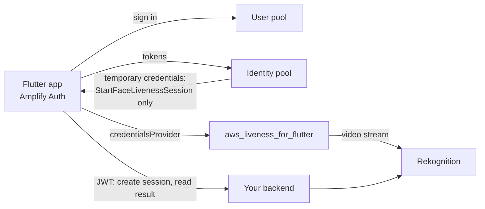

# cognito

Example for apps that already sign users in with Amazon Cognito. Instead of a credentials
endpoint, the app gets liveness credentials from a **Cognito identity pool**. Deployed with
AWS CDK (TypeScript), chosen over Amplify Gen 2 because the plugin does not use the Amplify
backend tooling and the IAM scope is easier to assert in a CDK test (`test/stack.test.ts`).

The plugin itself has **no Cognito dependency**. Only the small Flutter package in
[`flutter_client/`](flutter_client) uses `amplify_auth_cognito`.



Nothing in this folder has been deployed by the project's own tests; `npm run synth` only
renders the template locally.

## What the stack creates

- **User pool** with email sign-in, admin-created users by default (`-c selfSignUp=true` to
  allow sign-up), optional TOTP MFA and a 12-character password policy.
- **App client** without a secret, SRP sign-in, and `preventUserExistenceErrors`.
- **Identity pool** that accepts only signed-in users from that client. Guest identities are
  disabled and the guest role has no permissions.
- **Authenticated role** whose only permission is `rekognition:StartFaceLivenessSession`.
  Its trust policy is limited to this identity pool and authenticated identities.

## Why the app must not create sessions or read results

The identity pool hands AWS credentials to the device, and the device is not trusted. If
the authenticated role could call:

- `CreateFaceLivenessSession`, anyone signed in could create unlimited billable sessions
  outside your rate limits, and you would not know which user a session belongs to;
- `GetFaceLivenessSessionResults`, a modified app could read its own confidence score and
  claim success to your backend, or read other users' results by session id.

So the role allows streaming only. Session creation, the binding of each session to the
user, the threshold and the single-use rule stay on your backend. The
[`backend-lambda`](../backend-lambda) example covers that; put its API behind an HTTP API
JWT authorizer on this user pool (its README shows how) and bind sessions to the token's
`sub`.

## Credential lifetime

Amplify uses the identity pool's enhanced flow, which returns credentials valid for about
one hour, longer than the 15 minutes the [`backend-express`](../backend-express) and
`backend-lambda` examples issue. The blast radius stays small because the role can do
nothing but stream a liveness check. If you need a shorter lifetime, use the basic flow
(`GetOpenIdToken`, then `AssumeRoleWithWebIdentity` with `DurationSeconds: 900`) or the
backend credentials endpoint instead.

## Deploy

Requires Node.js 20.11 or later and AWS credentials for a profile that may deploy
CloudFormation stacks. Pick a [region with Face Liveness](../../doc/troubleshooting.md#regions).

```sh
npm ci
npm run lint && npm run typecheck && npm test

export AWS_REGION=eu-west-1
npm exec -- cdk bootstrap   # once per account and region
npm exec -- cdk deploy
```

Outputs: `UserPoolId`, `UserPoolClientId`, `IdentityPoolId` and `Region`. Create a user in
the Cognito console (or enable self sign-up). Remove everything with
`npm exec -- cdk destroy`.

## Use it in Flutter

[`flutter_client`](flutter_client) is a small package with one function. Add Amplify to
your app, configure it with the stack outputs, and pass the provider to the plugin:

```dart
import 'package:amplify_auth_cognito/amplify_auth_cognito.dart';
import 'package:amplify_flutter/amplify_flutter.dart';
import 'package:aws_liveness_for_flutter/aws_liveness_for_flutter.dart';
import 'package:liveness_cognito_client/liveness_cognito_client.dart';

const amplifyConfig = '''
{
  "auth": {
    "plugins": {
      "awsCognitoAuthPlugin": {
        "CognitoUserPool": { "Default": {
          "PoolId": "<UserPoolId>", "AppClientId": "<UserPoolClientId>", "Region": "<Region>"
        } },
        "CredentialsProvider": { "CognitoIdentity": { "Default": {
          "PoolId": "<IdentityPoolId>", "Region": "<Region>"
        } } }
      }
    }
  }
}''';

Future<void> setUpAmplify() async {
  await Amplify.addPlugin(AmplifyAuthCognito());
  await Amplify.configure(amplifyConfig);
}

Future<LivenessResult> check(String sessionId, String region) {
  // sessionId and region come from YOUR backend (CreateFaceLivenessSession).
  return AwsLiveness.start(
    LivenessRequest(
      sessionId: sessionId,
      region: region,
      credentialsProvider: cognitoCredentialsProvider(),
    ),
  );
}
```

Replace the placeholders with your outputs at build time; do not commit real pool ids.
After `LivenessCompleted`, ask your backend for the decision.

Checks for the package: `cd flutter_client && flutter pub get && flutter analyze && flutter test`.

## Development

| Script | What it does |
|---|---|
| `npm run lint` | ESLint with type-checked rules |
| `npm run typecheck` | `tsc --noEmit` |
| `npm test` | CDK assertions on the template (role scope, guest access, client settings) |
| `npm run synth` | Renders the template into `cdk.out` without AWS credentials |
